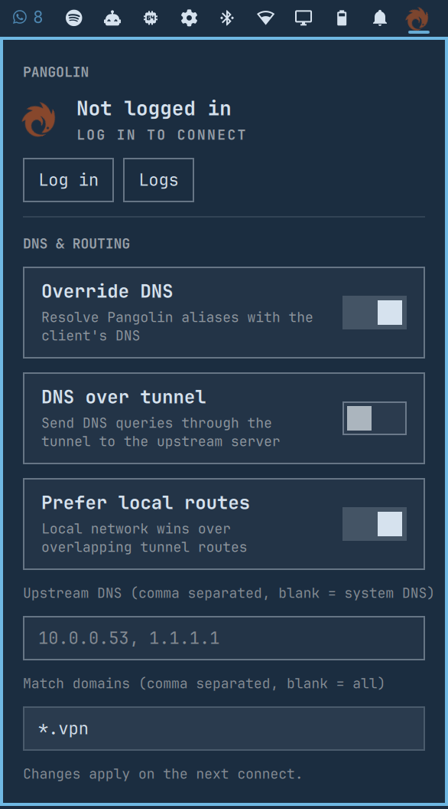

# OmaPangolin



A small Omarchy bar widget for the Pangolin CLI. It shows tunnel status and puts connect, disconnect, login, logs, peers, and DNS settings in one panel.

## Install

Install the `pangolin` CLI with Pangolin's official one-line installer, then make sure `jq` is available.

```bash
omarchy plugin add https://github.com/TerrifiedBug/omapangolin.git --enable
```

Connect and login open in a floating terminal. `pangolin up` needs sudo to create the WireGuard interface, including a FIDO touch when configured, and login uses terminal forms. The plugin doesn't run sudo from QML.

The first connection writes `/etc/pangolin/platform_fingerprint` under sudo.

## Using it

Left-click opens the panel. Right-click connects or disconnects when you're logged in.

Set `host` in the widget settings to skip Pangolin's hosting prompt on the first login. After that, the plugin uses the host saved by the Pangolin CLI.

The DNS controls write these settings with `pangolin config set`:

- `up.override_dns`
- `up.tunnel_dns`
- `up.prefer_local_routes`
- `up.upstream_dns`
- `up.match_domains_dns`

Changes apply on the next connection.

## IPC

```bash
omarchy-shell omapangolin status
omarchy-shell omapangolin connect
omarchy-shell omapangolin disconnect
omarchy-shell omapangolin login
omarchy-shell omapangolin logout
```

## Theme compatibility

Theme colors use a namespaced `qs.Commons.Color` import to avoid Qt 6.12's
`Color` name collision. This keeps the existing palette roles and fallbacks
without changing the plugin's Omarchy requirements.

## Privacy

Pangolin keeps account secrets in `~/.config/pangolin/accounts.json`. The plugin reads that file through `jq`, which returns the host, email, name, organization, and whether a session exists. The session token and OLM secret don't enter QML.

The Logs button follows `~/.config/pangolin/logs/client.log` in a floating terminal.
